# ambientCG: Wood Siding materials

**13 assets from [ambientCG](https://ambientcg.com), dedicated to the public domain under [CC0](https://docs.ambientcg.com/license/).** Use them in any game, free or paid, and change them however you like; no credit is needed.

PBR materials as 1K and 2K JPG maps (colour, normal GL and DX, roughness, AO, displacement), one folder per resolution. 386.9 MB in all.

This is a copy kept by [zuujis-cc0](https://github.com/zuujis-cc0) so game makers can take single files from GitHub. It is not made by or affiliated with ambientCG: the originals, often in more formats and higher resolutions, are on [ambientcg.com](https://ambientcg.com). If they help you, consider [supporting ambientCG](https://www.patreon.com/ambientCG).

Every file is listed in [MANIFEST.tsv](MANIFEST.tsv) with its size and SHA-256. More free assets: [the Zuujis collection](https://github.com/zuujis-cc0/free-game-assets#readme).

| | | | |
| :-: | :-: | :-: | :-: |
| <a href="WoodSiding001">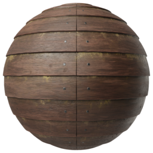</a> <b><a href="WoodSiding001">Wood Siding 001</a></b> by ambientCG · <a href="https://ambientcg.com/a/WoodSiding001">source</a> | <a href="WoodSiding002">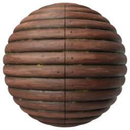</a> <b><a href="WoodSiding002">Wood Siding 002</a></b> by ambientCG · <a href="https://ambientcg.com/a/WoodSiding002">source</a> | <a href="WoodSiding003">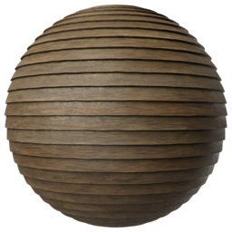</a> <b><a href="WoodSiding003">Wood Siding 003</a></b> by ambientCG · <a href="https://ambientcg.com/a/WoodSiding003">source</a> | <a href="WoodSiding004">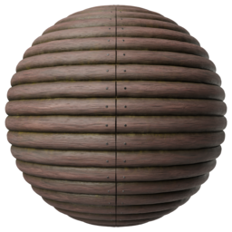</a> <b><a href="WoodSiding004">Wood Siding 004</a></b> by ambientCG · <a href="https://ambientcg.com/a/WoodSiding004">source</a> |
| <a href="WoodSiding005">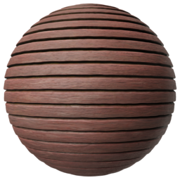</a> <b><a href="WoodSiding005">Wood Siding 005</a></b> by ambientCG · <a href="https://ambientcg.com/a/WoodSiding005">source</a> | <a href="WoodSiding006">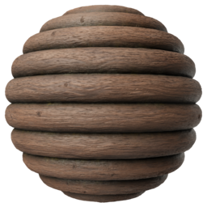</a> <b><a href="WoodSiding006">Wood Siding 006</a></b> by ambientCG · <a href="https://ambientcg.com/a/WoodSiding006">source</a> | <a href="WoodSiding007">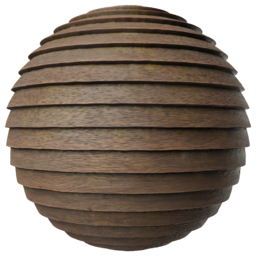</a> <b><a href="WoodSiding007">Wood Siding 007</a></b> by ambientCG · <a href="https://ambientcg.com/a/WoodSiding007">source</a> | <a href="WoodSiding008">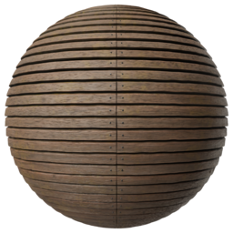</a> <b><a href="WoodSiding008">Wood Siding 008</a></b> by ambientCG · <a href="https://ambientcg.com/a/WoodSiding008">source</a> |
| <a href="WoodSiding009">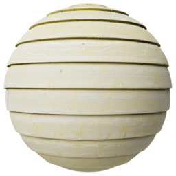</a> <b><a href="WoodSiding009">Wood Siding 009</a></b> by ambientCG · <a href="https://ambientcg.com/a/WoodSiding009">source</a> | <a href="WoodSiding010">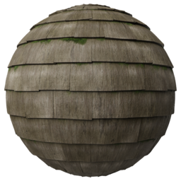</a> <b><a href="WoodSiding010">Wood Siding 010</a></b> by ambientCG · <a href="https://ambientcg.com/a/WoodSiding010">source</a> | <a href="WoodSiding011">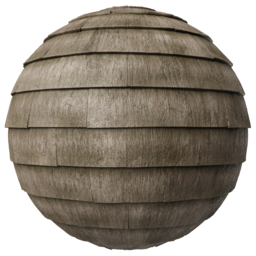</a> <b><a href="WoodSiding011">Wood Siding 011</a></b> by ambientCG · <a href="https://ambientcg.com/a/WoodSiding011">source</a> | <a href="WoodSiding012">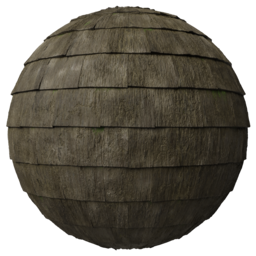</a> <b><a href="WoodSiding012">Wood Siding 012</a></b> by ambientCG · <a href="https://ambientcg.com/a/WoodSiding012">source</a> |
| <a href="WoodSiding013">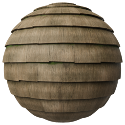</a> <b><a href="WoodSiding013">Wood Siding 013</a></b> by ambientCG · <a href="https://ambientcg.com/a/WoodSiding013">source</a> |  |  |  |

---

Kept up to date by this repository's own [update workflow](.github/workflows/update.yml), with code and plan from [cc0-mirror](https://github.com/zuujis-cc0/cc0-mirror). Something wrong? [Open an issue there](https://github.com/zuujis-cc0/cc0-mirror/issues/new) or use the [private report form](https://games.zuujis.com/report).
